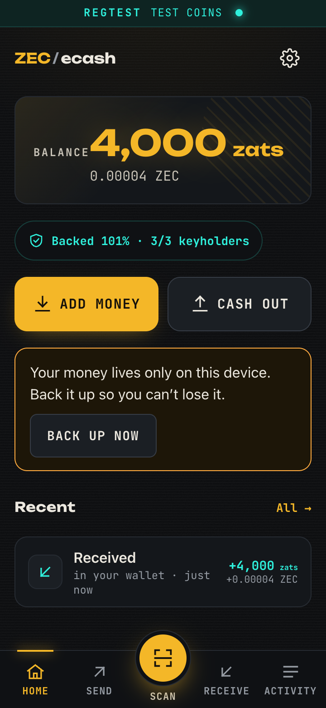
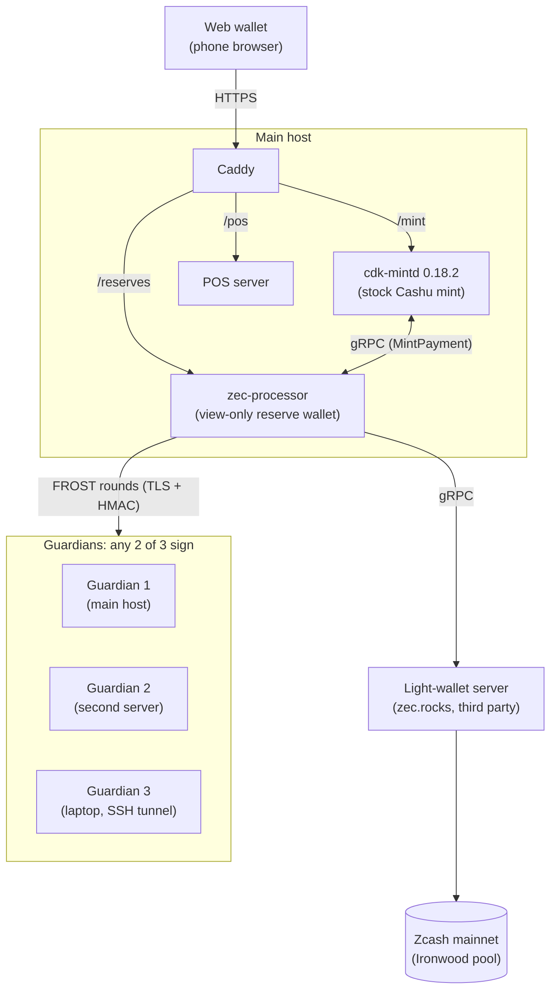
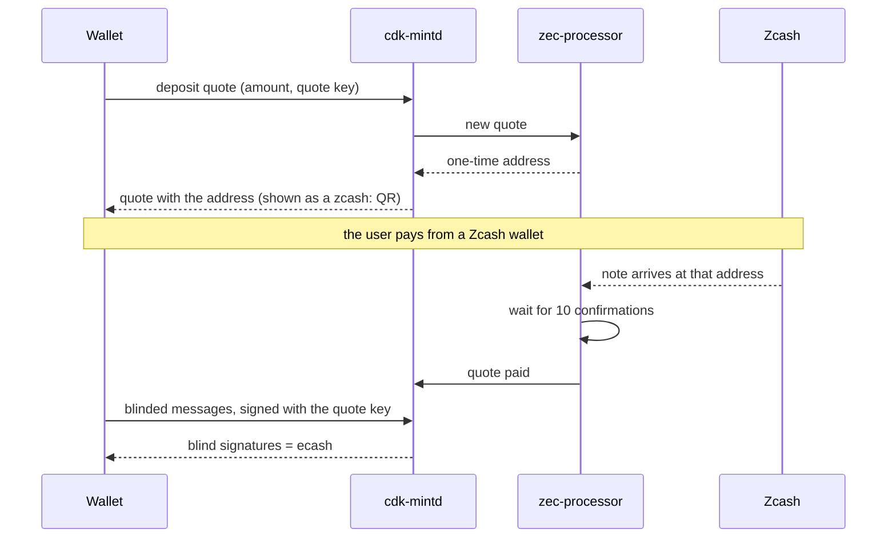
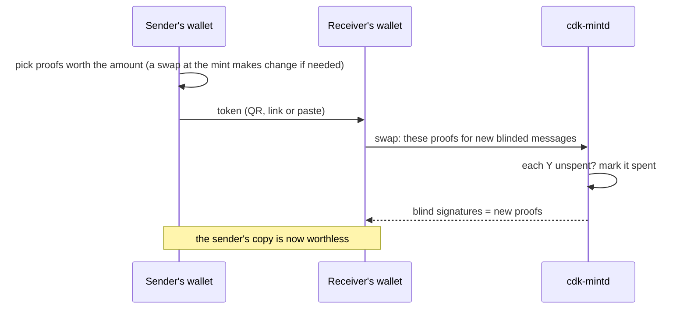
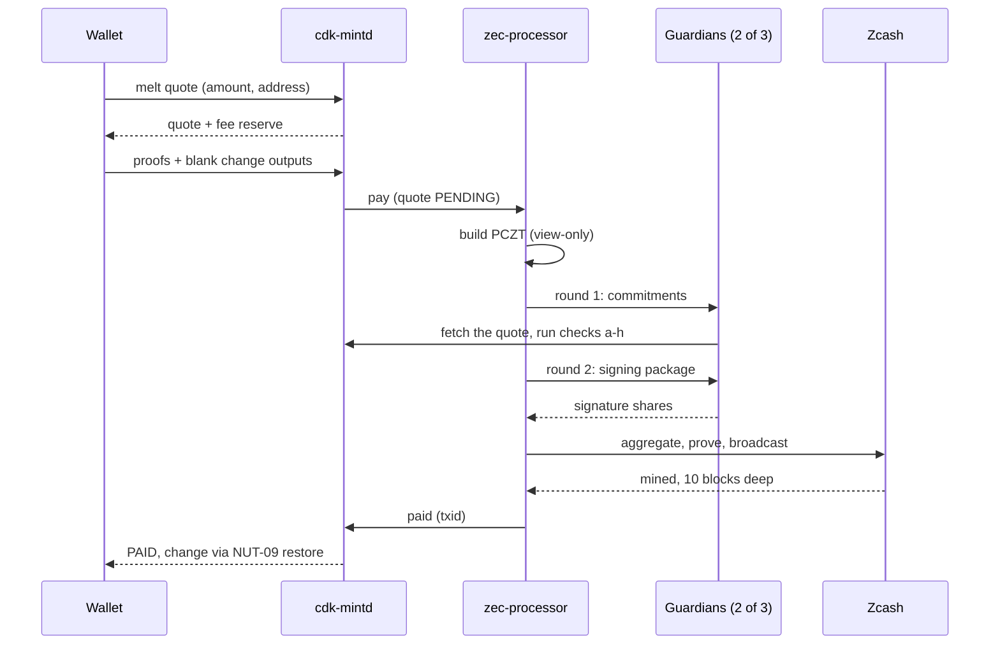
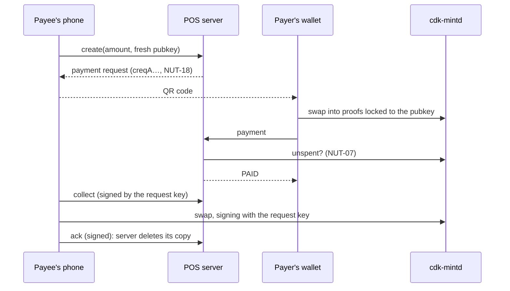

# zec-ecash: digital cash for Zcash

Instant, free, private payments in ZEC, from a phone, even when the person being paid has no
internet. zec-ecash is a Cashu ecash mint backed by shielded ZEC, and no single key can spend
the reserve.

 The phone wallet (devnet build, test coins).

## Try it now

- **The live wallet:** https://zecmint.duckdns.org. It runs in the browser; on a phone you can
  add it to the Home Screen.
- **Is my money safe?** https://zecmint.duckdns.org/#/status shows the reserve against all the
  ecash issued, live, and whether each keyholder (guardian) is online.
- **Judges: no ZEC needed.** Open https://zecmint.duckdns.org/#/judges, the guided tour of every
  feature, and tap **Get 25,000 zats** under "No ZEC?". It's real ecash, one per browser while
  they last. ([How the links are made](docs/judge-kit.md).) TODO(verify): deployed to mainnet,
  and the amount per link.
- **Video:** TODO(link).

Mainnet is live with real ZEC, behind a reserve cap. It is experimental: use small amounts.

## What it does

Think of a vault and banknotes. You put ZEC into the vault (the mint's shielded reserve) and get
banknotes back (ecash). The banknotes live on your phone. You pay someone by handing them over:
a QR code, a link or a message. Whoever holds a note can spend it or swap it back for ZEC at
any time.

That gives you four things a normal shielded payment doesn't:

- **Instant.** A payment settles as soon as the receiver's wallet swaps it at the mint; no
  waiting for blocks.
- **Free and tiny.** Moving ecash costs nothing, so a 1-zat payment makes sense.
- **The receiver can be offline.** A phone in airplane mode can safely accept a payment locked to
  it, and redeem it later.
- **The issuer can't trace payments.** Notes are signed blind, so the mint can't link the ecash
  it issued to the ecash it later sees spent.

What you can do in the wallet:

- **Add money:** send ZEC from a Zcash wallet to a one-time address; ecash appears once the
  deposit is confirmed.
- **Send and Receive:** show a code, scan a code, or paste one.
- **Receive without internet:** show your receive code; the sender locks the payment to you.
- **Request an amount:** a payment request (Cashu NUT-18) the payer scans and pays.
- **Shop mode:** a counter terminal, invoices and receipts (signed links and PDFs), CSV exports
  and a sales dashboard. Shop data stays on the device.
- **Cash out:** turn ecash back into ZEC, sent to a Zcash unified address with an Orchard
  receiver.
- **Status:** the live reserve check and the guardians, in plain words.

## Why it matters

Shielded Zcash is private, but it isn't made for small, everyday payments:

- **It's slow.** A payment is safe after confirmations. This mint waits for 10, about 12.5
  minutes at 75 seconds per block.
- **It always costs a fee.** ZIP 317 charges 5,000 zats per action, at least 10,000 zats per
  transaction. That's more than a coffee-sized payment should cost.
- **The receiver can't check a payment offline.** Their wallet has to sync the chain to see it
  arrive.

Ecash on top of shielded ZEC keeps the privacy and adds speed, zero fees and offline receiving.
Only deposits and cash-outs touch the chain.

And unlike a typical ecash mint, **no single key can spend the reserve.** It is held by a 2-of-3
threshold key (FROST): three keyholders (guardians) each hold one share, and each checks every
withdrawal against the mint's own record before signing. Today one operator runs all three
guardians ([limits](#limitations-and-roadmap)).

## How it works

### Architecture

**Point: a stock Cashu mint does the ecash; our processor does the Zcash side; three guardians
hold the reserve's key between them.**

| Component | What it does | Runs on |
|---|---|---|
| Web wallet (`web/`) | Holds the ecash in the browser; all wallet features; installable on a phone | the user's device |
| Caddy | HTTPS, serves the web wallet, routes `/mint`, `/pos` and the status paths | main host |
| cdk-mintd 0.18.2 | The stock Cashu mint: issues, swaps and redeems ecash; unchanged | main host |
| zec-processor (`crates/zec-processor`) | The Zcash side: deposit addresses, confirmations, building and broadcasting cash-outs, the reserve check | main host |
| Guardians (`crates/guardian`) | Each holds one FROST key share; re-checks a cash-out, then signs | guardian 1: main host; guardian 2: a second server; guardian 3: a laptop, reached over an SSH tunnel |
| POS server (`crates/pos`) | Holds payment requests and the payments made to them, which only the payee can spend | main host |
| Light-wallet server | Chain data and broadcasting (a third-party server, zec.rocks) | third party |

### Deposit

**Point: ZEC goes to a one-time address of the reserve; once it is confirmed, the wallet mints
the same amount of ecash.**

1. The wallet asks for a deposit quote (Cashu NUT-04, with the custom method `zec`, unit `zat`).
   The quote is locked to a key that only this wallet holds (NUT-20), so nobody else can mint
   with it.
2. The processor gives the quote a fresh diversified address of the reserve wallet. The wallet
   shows it as a QR code with the amount (a ZIP-321 `zcash:` link).
3. The processor syncs the view-only reserve wallet and credits each arriving note to its quote
   by the address's diversifier index.
4. At 10 confirmations (mainnet; 1 on the devnet) the processor tells the mint the quote is paid.
5. The wallet sends blinded messages, signed with its quote key (NUT-20), and gets back blind
   signatures: its new ecash.

**Restart safety.**
- **Processor:** quotes live in its database, and a paid event carries a fixed id per quote, so
  the mint records it once even if it arrives twice.
- **Web wallet:** it saves the outputs and their NUT-20 signature before sending them. If the
  answer is lost, a reload asks the mint to restore the signatures (NUT-09) instead of minting
  twice.
- **Progress bar:** `GET /deposit-quote?quote=<id>` reports confirmations so far and needed.

### Transfers

**Point: ecash is a set of mint-signed secrets. Paying means handing them over; the receiver
swaps them for new ones so the sender can't spend them again.**

**Blind signatures, by analogy.** You put a note in an envelope lined with carbon paper. The
mint signs the outside without opening it, and the signature goes through onto the note. Later
the mint recognises its own signature, but it never saw the note, so it can't tell when it
signed it.

> **The maths (Cashu NUT-00, blind Diffie-Hellman key exchange).** The mint has a private key
> `k` and public key `K = kG` for each amount. The wallet picks a secret `x` and maps it to a
> curve point `Y = hash_to_curve(x)`.
> - The wallet blinds it with a random `r`: `B' = Y + rG`.
> - The mint signs: `C' = kB'`.
> - The wallet unblinds: `C = C' − rK = kY`.
> - Later anyone presents `(x, C)`, and the mint checks `C = k·hash_to_curve(x)`.
>
> The mint saw only `B'`, which looks random, so it can't link `C` back to the signing.

- **The swap (NUT-03).** The receiver hands the mint the proofs it received and gets fresh
  ones. The mint records each spent proof by `Y` in its spent list, so a proof works once.
- **Checking a proof (NUT-07).** Anyone can ask the mint whether a proof is unspent, pending or
  spent, by `Y`.
- **Offline signature check (NUT-12, DLEQ).** A short proof that `C` was made with the same `k`
  as the mint's public key, so a wallet can check a signature without asking the mint.
- **Denominations.** Proofs come in powers of two (1, 2, 4, … zats). A swap makes the minimal
  set, one proof per set bit of the amount. If the wallet already holds proofs adding up to
  exactly the amount, it sends those as they are, without asking the mint.
- **Compact and full tokens.** A token (`cashuB…`) can leave out the DLEQ proofs: about half the
  size, but the receiver can't check it offline. Codes you show for anyone to take are compact
  by default; codes locked to someone always keep them. On the devnet a 3,000-zat token of 7
  proofs is 1,162 characters compact and 2,170 with DLEQ proofs.

### Cash out

**Point: the processor builds the transaction from a view-only wallet, two of three guardians
each check it against the mint and sign their share, and the mint only refunds if nothing can
reach the chain.**

1. **Quote (NUT-05).** The wallet asks to melt ecash to an address. The processor accepts only
   a unified address with an Orchard receiver, which pays into Ironwood. It prices the fee with
   a ZIP 317 proposal, and the mint returns a quote with a fee reserve.
2. **Melt.** The wallet sends proofs covering amount + fee reserve, plus blank outputs for
   change (NUT-08). The mint marks the quote PENDING and asks the processor to pay.
3. **Build.** The processor builds a partially created transaction (a PCZT) from the view-only
   reserve wallet. It never holds a spend key.
4. **Check.** Each guardian fetches the quote from the mint itself
   (`GET /v1/melt/quote/zec/{id}`) and re-derives everything from the PCZT. It signs only if all
   of these hold (`crates/guardian/src/policy.rs`):
   - **(a)** the mint says the melt is PENDING, in unit `zat`;
   - **(b)** exactly one output pays exactly the quoted amount to the quoted address;
   - **(c)** every other output with value goes back to the mint, and the transaction touches
     no transparent or Sapling funds;
   - **(d)** every spend is one of the mint's own notes (`verify_rk` / `verify_nullifier`
     against the mint's key);
   - **(e)** the fee is at most the quote's fee reserve;
   - **(f)** Ironwood's cross-address restriction holds;
   - **(g)** each message it is asked to sign is this PCZT's own sighash;
   - **(h)** it has never signed a different transaction for this quote.
5. **Sign (FROST over RedPallas).**
   - **Round 1:** each guardian commits to fresh nonces.
   - **Round 2:** each guardian that passed the checks returns a signature share.
   - **Aggregate:** the processor combines two shares into one ordinary RedPallas signature.
   - **Re-randomised:** each Orchard spend is signed under `rk = ak + [α]G`, so the signing is
     re-randomised with that spend's `α`.
   - **Transport:** the rounds go over TLS, and each request carries an HMAC.
6. **Broadcast.** The processor proves and extracts the transaction. It saves the txid, then
   broadcasts.
7. **Settle.** The melt stays Pending until the transaction is 10 blocks deep, then it is PAID.
   - **Change:** the mint's 0.18.2 quote response leaves out the change signatures. The wallet
     recovers them by restoring its blank outputs (NUT-09).

**Failures, crashes and reorgs** ([details](docs/processor.md#withdrawals)):
- **Refund rule.** The mint refunds the ecash when a melt fails. So a cash-out reports Failed
  only if nothing was broadcast, or the chain passed the transaction's expiry height and it
  wasn't mined. From the moment a PCZT is built until it is mined, it reports Pending.
- **Crash.** On restart, unbroadcast withdrawals fail (the mint refunds) and broadcast ones are
  sent again.
- **Reorg.** If the block holding a withdrawal is replaced, the withdrawal goes back to Pending
  and is rebroadcast. It settles only when its new block is deep enough.
- **Reorg after PAID.** A paid withdrawal stays watched for 100 blocks. If it is reorged out and
  then expires unmined, the processor flags it for the operator (`/reserves` shows it, with
  HTTP 503).

### Receive without internet

**Point: a receiver can't ask the mint whether a token is unspent, so it accepts one offline
only if nobody else could spend it.**

The sender locks the payment to the receiver's public key (Cashu NUT-11, P2PK; NUT-10 spending
conditions). Offline, the receiving wallet checks every proof in the token
(`web/src/wallet/offline.ts`). Any failure means "only accept it online":

- **The lock:** the proof is locked to this wallet's key, with no locktime, refund keys or
  other ways out.
- **The mint:** the token names this wallet's mint and unit.
- **The signature:** a valid DLEQ proof (NUT-12) against the mint keys this device saved while
  online.

Accepted tokens are queued and redeemed automatically, signing with the wallet's key, once the
mint is reachable.

**Why the sender needs a moment online:** locking is part of the signed secret, so locked proofs
have to be made by a swap at the mint. The receiver can stay offline the whole time.

### Payment requests and shop mode

**Point: the payee's phone creates each request with a fresh key; the payer locks the payment
to that key; the server stores it but can't spend it.**

- **Requests.** Receive › Request an amount asks the POS server (`crates/pos`) for a payment
  request (NUT-18).
  - **The key:** the request carries a NUT-10 lock to a fresh public key, derived from the
    wallet seed with one index per request (`web/src/wallet/posreq.ts`) and never reused.
  - **Restore:** a wallet restored from its seed finds its requests again by re-deriving the
    keys.
- **Paying.** The payer's wallet locks every proof to exactly that key, with DLEQ proofs and no
  locktime or refund keys, and posts it to the request's address.
- **What the server checks, without claiming anything:**
  - the mint and the unit;
  - the exact lock, with no locktime, refund or extra keys;
  - a DLEQ proof on every proof;
  - every proof unspent (NUT-07);
  - no proof accepted twice (by `Y`).
  A payment that fails any check is refused.
- **Collecting.** The phone fetches the payment with a request signed by the request key
  (BIP-340 Schnorr, within 60 s). It swaps the proofs at the mint, signing with the same key,
  then sends a signed acknowledgement, and the server deletes its copy.
- **Nothing is lost.** A valid payment can't be refused without stranding it, so the server
  keeps every one the payee should know about:
  - **Extra:** it lost a race, or arrived after the request was paid.
  - **Partial:** it was short; the request stays unpaid.
  - **Late:** it arrived after the request expired or was cancelled. It doesn't pay the
    request, and it's kept for a refund.
  The payee collects all of them and can refund them.
- **Expiry and cancel.** A request can carry an expiry; the payee can cancel it with a signed
  request. The web wallet checks `/check/<id>` before paying and won't pay a closed request.
- **Shop mode.**
  - **Counter and invoices:** a counter terminal and invoices, both built on these requests.
  - **Signed links:** invoice and receipt links work even with the shop offline. The document
    is signed (BIP-340) with the request's key, compressed, and put in the URL fragment
    (`#/invoice/…`, `#/receipt/…`), which browsers never send to a server. The signature stops
    the items or total being changed; it doesn't prove who the shop is.
  - **Data on the device:** profile, catalogue and invoices stay in the shop's browser
    (IndexedDB), and are included in its backup.

### Proof of reserves

**Point: after every sync the processor checks that the confirmed reserve covers all ecash
outstanding plus every cash-out in flight, and publishes the result.**

`confirmed reserve ≥ outstanding + in flight`, where:

- **Confirmed reserve:** the reserve wallet's shielded notes at 10 confirmations, plus the
  mint's own change from mined withdrawals. A note spent by a not-yet-mined withdrawal still
  counts; it is still on chain.
- **Outstanding:** ecash issued − ecash redeemed − melt inputs still pending, read from
  cdk-mintd's database.
- **In flight:** amount + fee of withdrawals whose transaction isn't mined yet.

These are chosen so a withdrawal never trips the check at any stage.

**What's published.**
- **`GET /reserves`** (and the Status page) shows the three figures, the chain height, the
  guardians' health and any withdrawal awaiting the operator, by quote id and amount only.
- **Never published:** addresses, txids and guardian URLs. `zec-processor operator-actions`
  prints a flagged withdrawal's address, txid and reason on the host.

**On a shortfall:**
- `/reserves` answers HTTP 503.
- The processor logs `RESERVE INVARIANT VIOLATED` once a minute.
- New deposits are refused.

A reserve cap (1,000,000 zats by default) also refuses deposits that could push the reserve past
it.

### Privacy model

**Point: payments between ecash users are hidden from the mint and the chain; deposits and
cash-outs are visible to the mint operator.**

**Hidden, and why:**
- **Who paid whom.** Blind signatures mean the mint can't link a deposit to the ecash later
  spent, sent or cashed out.
- **Payments between users** never touch the chain.
- **On chain,** the reserve's deposits and cash-outs are shielded (Ironwood), so amounts and
  addresses aren't public.
- **Payment requests:** each one uses a fresh key, so the mint can't link one shop's payments
  when they are redeemed.

**Revealed:**
- **To the mint operator:** deposit and cash-out amounts and times, and each cash-out's address.
- **To the guardians:** each cash-out's address, which they read from the mint's quote to check
  it.
- **To the mint, through timing:** a deposit followed shortly by a cash-out of a similar amount
  can be linked.
- **To each server you connect to:** your IP address.
- **To the POS server:** request amounts and payment times.
- **To the light-wallet server (zec.rocks):** the mint's own broadcasts and chain queries.

**Practical advice:**
- Deposit and cash out round amounts.
- Wait between depositing and cashing out.
- Cash out to a fresh address.
- Use a VPN or Tor to hide your IP address.

### Trust and security model

**Point: you trust the mint operator to stay online and honest about issuing, the guardians for
custody, and the light-wallet server for chain data.**

| You trust | For | If it fails |
|---|---|---|
| The mint (cdk-mintd + processor, main host) | Availability; issuing ecash only for real deposits | You can't redeem or cash out while it's down. A dishonest mint could issue unbacked ecash: the reserve check reads the mint's own records, so it can't catch a mint that lies about them. |
| The guardians (2 of 3) | Custody of the reserve | Any two together can spend it; one alone can't |
| The light-wallet server | Chain data and broadcasting | Deposits or cash-outs stall; it can't move funds |

| Threat | How it's handled |
|---|---|
| The main host is compromised | It holds one key share (guardian 1) and the guardians' auth secrets, so it can ask guardians 2 and 3 to sign. They sign only a transaction matching a PENDING quote that the mint reports, but that mint runs on the same host. **This limits a compromised processor, not a compromised mint.** |
| One guardian is compromised | One share can't sign. It can refuse to sign; the other two still can. |
| A reorg | Withdrawals return to Pending and are rebroadcast; PAID only at depth; paid withdrawals are watched for 100 blocks. |
| A crash mid-withdrawal | The txid is saved before broadcast; on restart, unbroadcast withdrawals fail (refunded) and broadcast ones are resent. |
| A double spend | The mint's spent list by `Y`; the swap is atomic. The POS server also checks NUT-07 and refuses a reused `Y`. |
| A stolen token | Ecash is a bearer note: whoever redeems first gets it. Locked tokens (receive codes, payment requests) can only be redeemed by the key holder. A backup file is spendable money too. |
| A guardian round replayed or forged | Each round request carries an HMAC over method, path, timestamp and body, within 60 s and never replayed, checked before any nonce is made; TLS on mainnet. |

**What's real and what's limited:**

| | Status |
|---|---|
| Deposits, transfers, cash-out with FROST, Status page, offline receive, payment requests | Live on mainnet ([evidence](docs/mainnet-evidence.md)) |
| Shop mode | In the mainnet web wallet; tested end to end on the devnet (`npm run e2e:shop`) |
| Judge kit | Claim links, the tour and public links (one per browser), tested end to end on the devnet (`npm run e2e:judge`); TODO(verify): deployed to mainnet? ([runbook](docs/judge-kit.md)) |
| Reorg handling | Unit-tested (`crates/zec-processor/src/withdraw.rs`); TODO(verify): tried by hand on the devnet with `invalidateblock`? |
| Guardian independence | Simulated: one operator runs all three (two servers and a laptop) |
| Chain data | A third-party light-wallet server (zec.rocks); no node of our own |
| Mint | Stock cdk-mintd 0.18.2. It reports every failed cash-out quote as "Unit unsupported"; the wallet asks the processor for the real reason. |
| Audit | None |
| Size | A reserve cap (1,000,000 zats by default); deposits and cash-outs from 10,000 to 1,000,000 zats each |

## Technology

**Stack** (versions from `Cargo.toml` and `web/package.json`):

| Part | What |
|---|---|
| Mint | `cdk-mintd` 0.18.2, unmodified; `cdk`, `cdk-common`, `cdk-payment-processor`, `cdk-redb` 0.18.2 |
| Zcash | librustzcash crates: `zcash_primitives` 0.30.1, `zcash_protocol` 0.10.6, `zcash_keys` 0.16.1, `zcash_client_backend` 0.24.0, `zcash_client_sqlite` 0.22.0, `zcash_proofs` 0.30.0, `pczt` 0.9.3; `orchard` =0.15.5 |
| Threshold signing | `reddsa` 0.5 (FROST over RedPallas), `frost-rerandomized` 3.0.0 |
| Network upgrade | Ironwood (NU6.3), mainnet activation at block 3,428,143 (asserted in `crates/zec-network`) |
| Devnet node | Zebra 6.4.2 (regtest, with its built-in light-wallet gRPC) |
| Web wallet | `@cashu/cashu-ts` 4.11.0, Vite 6.4.3, TypeScript 5.9.3, `pdf-lib` 1.17.1, `qr-scanner` 1.4.2, `qrcode` 1.5.4, `@noble/curves` and `@noble/hashes` 2.4.0 |
| Serving | Caddy (HTTPS, static files, reverse proxy) |

**Cashu NUTs used:**

| NUT | For |
|---|---|
| 00 | Blind signatures and `cashuB` tokens |
| 01, 02 | The mint's public keys and keysets |
| 03 | Swaps: receiving, change, making locked tokens |
| 04 | Deposits (mint quotes), custom method `zec`, unit `zat` |
| 05 | Cash-outs (melt quotes), method `zec` |
| 06 | Mint info (`/v1/info`) |
| 07 | Proof states: the POS server's checks, "was my token received?" |
| 08 | Blank outputs for a cash-out's change |
| 09 | Restoring signatures whose answer was lost (deposits, change, payment collection) |
| 10, 11 | Spending conditions and P2PK locks: offline receive, payment requests |
| 12 | DLEQ proofs: checking mint signatures offline |
| 18 | Payment requests (`creqA…`) |
| 20 | Deposit quotes locked to the wallet's key |

**Why these choices:**
- **A separate gRPC processor:** the mint is stock cdk-mintd, which needs no changes, and the
  Zcash crates can't share a Cargo build with the mint's own crates anyway (`libsqlite3-sys`,
  `sha2`).
- **A view-only reserve wallet and FROST:** no process ever holds the whole spend key.
- **PCZTs:** the guardians can check the exact transaction they sign.
- **Ironwood (Orchard-format addresses):** the reserve and every cash-out stay shielded.
- **A light-wallet server only:** the processor needs no local node on mainnet.
- **A web wallet:** nothing to install; it works on any phone, and offline.

## Repository layout

| Path | What |
|---|---|
| `crates/zec-processor` | The mint's payment backend: deposits, cash-outs, FROST coordination, reserve check, status endpoints |
| `crates/guardian` | One FROST key share: DKG ceremony, signing policy (checks a-h), TLS + HMAC transport |
| `crates/zec-frost` | FROST (RedPallas, re-randomised) helpers and wire format shared by processor and guardians |
| `crates/zec-wallet` | Zcash wallet library (light-wallet sync, PCZT building, FROST signer) used by the processor and devwallet |
| `crates/zec-network` | Which network (`ZEC_NETWORK`): consensus parameters, ports and defaults |
| `crates/pos` | Payment-request (NUT-18) server, and the public judge links; ported from thesimplekid's cashu-payment-backend |
| `crates/zec-ecash-cli` | Demo ecash wallet CLI on CDK (deposit, send, receive, pay, withdraw, reserves, judge kits) |
| `crates/devwallet` | Regtest Zcash wallet for the devnet (pays deposits, receives cash-outs) |
| `crates/devlog` | Size-capped log files |
| `web/` | The web wallet (Vite + TypeScript + cashu-ts), with unit and browser tests |
| `mintd/` | cdk-mintd configs (`config.toml` devnet, `config.mainnet.toml`) |
| `scripts/` | Devnet start/reset/DKG, mint host and certificates, guardian control, guardian CA, mainnet start, server checks, log trimming |
| `deploy/` | Caddyfile, systemd units and env templates for mainnet |
| `devnet/` | Devnet state (gitignored) plus `mine.sh` and the Zebra config |
| `docs/` | [Mainnet deployment](docs/deploy-mainnet.md), [processor reference](docs/processor.md), [devnet details](docs/devnet.md), [judge kit](docs/judge-kit.md), [mainnet evidence](docs/mainnet-evidence.md) |

## Run it locally (devnet)

Everything runs on one machine against a private regtest chain.
[docs/devnet.md](docs/devnet.md) has the details.

**Prerequisites:**
- Rust stable (`rustup`) and `protoc` (`brew install protobuf` or
  `apt-get install protobuf-compiler`).
- `cargo install zebrad --version 6.4.2 --locked`
- `cargo install cdk-mintd --version 0.18.2 --locked`
- `CDK_MINTD_MNEMONIC="<24 words>"` in `.env`, the mint's only mnemonic source.
- For the web wallet: Node 20 or newer and `mkcert`.

**Start the devnet.** First time on a fresh chain, also create the keys and mine past coinbase
maturity (see [devnet.md](docs/devnet.md#keys-devnetkeys-gitignored-survives-every-reset)).

    scripts/devnet-up.sh            # zebrad, guardians 1-3, zec-processor, cdk-mintd, web, pos
    scripts/devnet-up.sh status     # one line per service
    source scripts/env.sh           # mint URL and CA into this shell

**The web wallet over HTTPS:**

    (cd web && npm ci)
    scripts/set-mint-host.sh --init     # first time: adopt mkcert's root as web/certs/rootCA.pem
    scripts/set-mint-host.sh            # point everything at this Mac's .local name

Then open `https://<LocalHostName>.local:5173`. On a phone, trust `web/certs/rootCA.pem` first
([how](docs/devnet.md#web-wallet-on-a-phone)).

**Deposit, send, receive, cash out with the CLI:**

    cargo run -p zec-ecash-cli -- deposit 50000         # prints an address, waits, mints
    cargo run -p devwallet -- send <that address> 50000 && ./devnet/mine.sh 1   # in another terminal
    cargo run -p zec-ecash-cli -- send 5000             # prints a cashuB token and a QR code
    cargo run -p zec-ecash-cli -- --wallet bob receive <token>
    cargo run -p zec-ecash-cli -- withdraw 20000 $(cargo run -q -p devwallet -- address)
    ./devnet/mine.sh 1                                  # the CLI prints PAID and the txid
    cargo run -p zec-ecash-cli -- reserves              # the reserve check

**Tests:**

    cargo test --workspace                    # Rust unit tests
    (cd web && npm test)                      # web unit tests
    (cd web && npm run e2e:devnet)            # browser tests on the running devnet
    (cd web && npm run e2e:shop)
    (cd web && npm run e2e:beginner)
    (cd web && npm run e2e:judge)             # judge kit: claim links, the tour, public links
    (cd web && npm run e2e:audit)             # accessibility audit
    (cd web && NODE_EXTRA_CA_CERTS=certs/rootCA.pem node tests/e2e/pos-api.mjs)
    (cd web && node --experimental-websocket tests/e2e/pos-page.mjs)

The browser tests need headless Chrome. The ones that deposit can hit the reserve cap on a
long-used devnet ([fix](docs/devnet.md#start-check-reset)).

## Deploying on mainnet

1. Three machines: a main host (Caddy, cdk-mintd, zec-processor, guardian 1), a second server
   (guardian 2) and a third machine (guardian 3).
2. A distributed key ceremony (DKG): each guardian makes its own key share on its own machine.
3. TLS and per-guardian HMAC secrets between the processor and the guardians.
4. `mainnet/.env`, the systemd units in `deploy/systemd/`, and Caddy from `deploy/Caddyfile.example`.
5. A first deposit and cash-out by the operator, behind the reserve cap.

Step by step: [docs/deploy-mainnet.md](docs/deploy-mainnet.md).

## Mainnet evidence

Deposit and cash-out transactions, block heights and `/reserves` snapshots:
[docs/mainnet-evidence.md](docs/mainnet-evidence.md).

## Limitations and roadmap

**Limits today:**
- **Guardians:** one operator runs all three, so the 2-of-3 split is real in the code but not
  yet in who holds the keys. A compromised main host also controls the mint the guardians check
  against.
- **Chain data:** comes from a third-party light-wallet server.
- **Audit:** none.
- **Size:** small amounts only, with a reserve cap of 1,000,000 zats by default.
- **Cash-out errors:** the stock mint shows every failed cash-out quote as "Unit unsupported";
  the wallet asks the processor for the real reason.
- **Storage:** the web wallet's money lives in one browser's storage; a backup file is the only
  copy elsewhere.

**Next steps (not done):**
- Guardians run by different, independent people.
- Our own Zcash node instead of a third-party server.
- Paying in Zcash directly at the shop counter.
- A Cashu NUT proposal for a Zcash payment method.
- A security audit.

## Credits and license

- [Cashu](https://cashu.space) and the [Cashu Development Kit (CDK)](https://github.com/cashubtc/cdk):
  the protocol, `cdk-mintd` and the Rust wallet.
- [cashu-ts](https://github.com/cashubtc/cashu-ts): the web wallet's Cashu library.
- thesimplekid's [cashu-payment-backend](https://github.com/thesimplekid/cashu-payment-backend)
  (MIT): the reference for the POS server in `crates/pos`.
- Electric Coin Company's librustzcash crates (`zcash_*`, `pczt`) and `orchard`.
- The Zcash Foundation's Zebra, `reddsa` and FROST crates.

Licensed under the [Apache License 2.0](LICENSE). `crates/pos` is ported from thesimplekid's
cashu-payment-backend (MIT); its header lists the changes.
